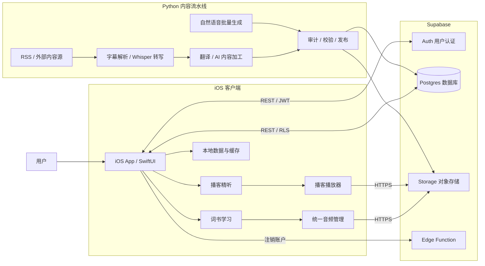
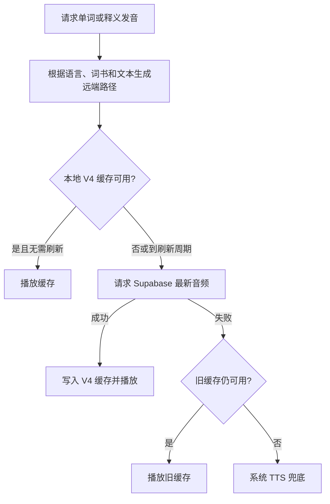
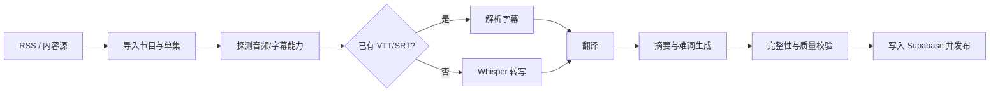

# 听会儿 App 架构总览

> 文档目的：帮助开发、排障和发布时快速建立全局认识。  
> 更新时间：2026-10-21  
> 当前代码目录：`/Users/mimashi0000/Downloads/听会儿`

不熟悉文中技术名词时，可配合阅读：[听会儿 App 技术名词解释](./app-technical-glossary.md)。

## 1. 一句话概括

“听会儿”是一个原生 iOS 语言学习应用，当前有两条核心业务线：

1. **词书学习**：德语、英语单词卡，自动播放单词和中文/英文释义，记录学习进度与收藏。
2. **播客精听**：聚合播客，提供音频播放、逐句文本、翻译、AI 摘要、难词和生词收藏。

整体采用“**iOS 原生客户端 + Supabase 云服务 + Python 离线内容流水线**”的架构：

- iOS 客户端负责界面、播放、缓存、本地状态和云端同步；
- Supabase 负责用户认证、业务数据、音频对象存储和行级权限；
- Python 脚本负责批量生成自然发音、抓取与加工播客、转写、翻译、校验和发布。

## 2. 系统全景图



核心原则是：**客户端消费已经加工好的内容，耗时和需要密钥的任务放在后端脚本执行。**

## 3. 仓库结构

```text
听会儿/
├── 听会儿/                         # iOS App 源码与内置词书
│   ├── ___App.swift                # App 入口
│   ├── ContentView.swift           # 主导航与词书业务入口
│   ├── Models.swift                # 词书、单词、语言等模型
│   ├── AudioPlayerManager.swift    # 单词/释义播放、下载、缓存、TTS 兜底
│   ├── PodcastFeature.swift        # 播客领域模型、Store、播放器与页面
│   ├── SupabaseClient.swift        # Supabase REST 接口封装
│   ├── AuthStore.swift             # 登录态与 Token 生命周期
│   ├── LearningProgressStore.swift # 学习进度本地保存与云同步
│   ├── KeychainStore.swift         # Token 安全存储
│   ├── AppPolicy.swift             # 跨功能产品规则
│   ├── SupabaseConfig.swift        # Supabase 地址、公开 Key、音频版本
│   └── data/                       # 随 App 打包的词书 JSON
├── backend/
│   ├── scripts/                    # 播客和学习音频批处理脚本
│   ├── config/rss_sources.json     # 播客源配置
│   ├── generated/                  # 本地生成的音频和中间产物
│   ├── reports/                    # 审计、清单和验证结果
│   ├── requirements.txt            # 基础 Python 依赖
│   └── requirements-transcription.txt
├── supabase/
│   ├── sql/                        # 数据表、策略、存储桶相关迁移
│   └── functions/delete-account/   # 注销账户 Edge Function
├── docs/                           # 产品、架构、音频和运维文档
├── Config/Info.plist
├── 听会儿.xcodeproj/
└── 听会儿Tests/                    # 当前少量单元测试
```

## 4. 技术栈

| 层级 | 技术 | 用途 |
|---|---|---|
| iOS UI | Swift 5、SwiftUI | 页面、导航、状态驱动 UI |
| 响应式状态 | Combine、`ObservableObject` | Store 和播放状态更新 |
| 音频 | AVFoundation、MediaPlayer | 单词音频、播客播放、锁屏媒体控制 |
| 本地语言能力 | NaturalLanguage、Translation | 语言处理及系统翻译能力 |
| 网络 | Foundation `URLSession` | 直接调用 Supabase REST/Auth/Storage |
| 安全存储 | Security / Keychain | 保存访问与刷新 Token |
| 普通本地状态 | UserDefaults | 偏好、进度副本、缓存元数据 |
| 云数据库 | Supabase Postgres | 用户状态、播客、逐句文本、AI 内容 |
| 用户体系 | Supabase Auth | 注册、登录、会话刷新 |
| 文件存储 | Supabase Storage | 学习音频及可选播客镜像 |
| 云端函数 | Supabase Edge Functions / TypeScript | 安全注销账户 |
| 内容流水线 | Python 3 | RSS 导入、转写、翻译、TTS、上传、验证 |
| Python 主要依赖 | `httpx`、`feedparser`、`edge-tts`、`gTTS`、`python-dotenv` | 网络、订阅源、语音生成和配置 |
| 可选转写 | faster-whisper / openai-whisper | 播客音频转写 |

目前客户端没有依赖 Supabase Swift SDK，而是由 `SupabaseClient.swift` 使用 `URLSession` 直接访问 REST 接口。优点是依赖少、调用透明；代价是鉴权刷新、错误映射和接口模型需要项目自行维护。

## 5. iOS 客户端架构

### 5.1 应用入口与导航

`___App.swift` 创建 SwiftUI App，根页面为 `ContentView`。

`ContentView.swift` 当前承担较多顶层职责，包括：

- 欢迎页与首次启动流程；
- 登录/用户状态接入；
- 学习语言和词书选择；
- 单词播放器入口；
- 搜索、设置、自定义词书等页面跳转；
- 词书模块与播客模块之间的主导航。

当前实现以 SwiftUI 状态和多个 `ObservableObject` Store 为核心，没有引入 Redux、TCA 或大型依赖注入框架。

### 5.2 词书领域

主要文件：

- `Models.swift`：`StudyLanguage`、`LearningLanguage`、`Word`、`WordBook`、`DataLoader` 等；
- `WordCardPlayerView.swift`：主要单词卡播放页面；
- `AutoWordPlayerView.swift`：自动播放相关页面；
- `LearningProgressStore.swift`：进度、收藏及云同步；
- `AppPolicy.swift`：播放速度范围、音标显示等统一规则。

内置词书位于 `听会儿/data/`：

| 文件 | 用途 |
|---|---|
| `A1.json`、`A2.json`、`B1.json` | 德语分级词书 |
| `IELTS_9400.json` | 雅思英语词书 |
| `KaoYan_2.json` | 考研英语词书 |
| `12yue.json` | 特定小型词集 |

这些 JSON 随 App Bundle 发布，因此**词条正文的更新通常需要发布新版 App**；与之不同，Supabase 中的音频可以在不发新版的情况下独立替换。

### 5.3 播客领域

播客相关实现目前集中在 `PodcastFeature.swift`，主要组成包括：

- 目录：`PodcastCatalogStore`、播客节目和单集模型；
- 收藏：`PodcastCollectionStore`、`PodcastLibraryStore`；
- 播放：`PodcastPlayerStore`、`PodcastAudioDownloader`；
- 内容：逐句文本、双语翻译、AI 摘要、难词；
- 学习：`PodcastWordStore`、单词查询、发音和生词花园；
- 页面：推荐、节目列表、单集播放器、AI 洞察、收藏单词等。

播客音频和词汇短音频是两套不同链路：前者是长音频播放与下载，后者由 `AudioPlayerManager` 进行短音频缓存和 TTS 兜底。

### 5.4 客户端状态分层

| 状态类型 | 位置 | 典型内容 |
|---|---|---|
| 页面瞬时状态 | SwiftUI `@State` | 当前弹窗、页面选择、播放按钮状态 |
| 跨页面业务状态 | `ObservableObject` Store | 登录、学习进度、播客目录、播放器 |
| 轻量持久状态 | UserDefaults | 用户偏好、本地进度副本、缓存信息 |
| 敏感凭证 | Keychain | Supabase access/refresh token |
| 可同步业务数据 | Supabase Postgres | 用户进度、收藏、播客内容、AI 内容 |
| 大文件 | Supabase Storage / 本地 Cache | 自然发音、播客音频、下载文件 |

## 6. Supabase 云端架构

### 6.1 服务职责

Supabase 在当前架构中同时提供：

- **Auth**：邮箱等用户身份和会话；
- **Postgres + REST**：业务数据查询和写入；
- **Row Level Security（RLS）**：限制用户只能访问自己的私有数据；
- **Storage**：公开读取的学习音频，以及可选播客音频镜像；
- **Edge Function**：执行需要服务端权限的账户删除。

### 6.2 主要数据实体

根据现有 SQL，核心数据可分成四组：

| 数据组 | 代表实体 | 说明 |
|---|---|---|
| 用户 | `profiles`、`user_app_state` | 用户资料和跨设备 App 状态 |
| 学习 | `learning_progress`、`favorite_words` | 学习位置、进度和收藏 |
| 播客 | `podcasts`、`episodes`、`episode_sentences` | 节目、单集、逐句内容 |
| AI 学习内容 | AI insights、difficult words、双语释义相关表 | 摘要、难词、翻译等预生成内容 |

公开内容通过“已发布/已审核”等状态配合 RLS 对客户端开放；用户私有内容通常按 `auth.uid()` 隔离。

### 6.3 客户端访问方式

`SupabaseConfig.swift` 保存：

- Supabase 项目 URL；
- publishable/anon key；
- 学习音频 bucket 名；
- 英语和德语远端音频版本。

publishable/anon key 出现在客户端是正常设计，真正的数据权限必须由 RLS 保证。`service_role` 密钥只能留在后端 `.env` 或安全运行环境中，不能打入 App、文档或 Git。

## 7. 学习音频架构

### 7.1 播放决策



主要实现文件是 `AudioPlayerManager.swift`。设计目标是：

1. 正常情况播放 Supabase 中的自然语音；
2. 已下载内容保留缓存模式，减少流量和等待；
3. 通过刷新策略和 URL cache-buster 避免永久命中旧音频；
4. 网络失败或对象不存在时使用系统语音，不阻塞学习；
5. 用户安装新版本或覆盖更新后，不被旧版缓存目录污染。

### 7.2 三个容易混淆的“版本”

| 名称 | 示例 | 实际含义 |
|---|---|---|
| Storage API 路径 | `/storage/v1/object/public/...` | Supabase 固定接口版本，不代表音频新旧 |
| 远端内容版本 | `v2/words/en-US/...` | 项目定义的单词音频目录版本 |
| 客户端缓存版本 | `Library/Caches/TingHuiErAudioV4/...` | 本机缓存命名空间，用于和旧缓存隔离 |

因此，看到 Supabase URL 中的 `/v1/` 并不表示仍在使用第一版音频；判断具体音频版本应看 bucket 后面的对象路径以及实际文件内容。

### 7.3 远端对象组织

当前 bucket：`learning-audio`

典型路径：

```text
learning-audio/
├── v2/words/de-DE/{book}/{generated-name}.mp3
├── v2/words/en-US/{book}/{generated-name}.mp3
└── meanings/
    ├── zh/{generated-name}.mp3
    └── en/{generated-name}.mp3
```

- 单词音频按语言和词书区分；
- 中文释义音频按规范化后的释义内容生成稳定文件名；
- 相同的中文释义可以跨雅思、考研等词书复用同一个对象；
- 找不到远端对象时，客户端最终使用系统 TTS 兜底。

完整的文件名算法、Supabase 查看方式、本地缓存位置和排障命令见：[`learning-audio-paths.md`](./learning-audio-paths.md)。

## 8. 播客内容流水线

播客内容不是由手机实时完成转写和 AI 分析，而是先由后端加工后发布。



主要脚本在 `backend/scripts/`，包括：

- RSS/节目内容处理；
- 字幕解析或 Whisper 转写；
- 逐句翻译；
- AI 摘要和难词生成；
- 单集质量校验；
- 最新内容发布；
- 学习音频生成、上传和远端一致性验证。

播客来源由 `backend/config/rss_sources.json` 配置。AI 服务密钥、Supabase 服务端密钥等仅从后端环境变量读取。

## 9. 关键业务流程

### 9.1 用户学习单词

1. App 从 Bundle 加载所选词书 JSON；
2. 页面展示单词、音标和释义；
3. `AudioPlayerManager` 计算对应 Supabase 对象路径；
4. 优先复用有效缓存，否则下载远端自然音频；
5. 远端异常时回退到本地旧缓存或系统 TTS；
6. 学习进度先写本地，登录用户再同步 Supabase。

### 9.2 用户收听播客

1. App 从 Supabase 查询已发布节目和单集；
2. 播放远端节目音频或本地已下载副本；
3. 按播放位置展示逐句文本和中文翻译；
4. 按需读取 AI 摘要、难词和收藏状态；
5. 用户收藏、进度等私有状态写入自己的云端记录。

### 9.3 后端替换自然发音

1. 根据内置词书生成待处理 manifest；
2. 用统一 voice 和参数生成 MP3；
3. 对数量、时长、文件内容进行审计；
4. 以覆盖模式上传到原有稳定对象路径；
5. 远端下载比对，确认没有上传到错误目录；
6. 客户端在刷新窗口到达后下载新文件并更新 V4 缓存。

这种方式允许**先发布客户端，再持续补齐或替换后端音频**，前提是客户端已经包含稳定的路径算法、缓存刷新和系统语音兜底。

## 10. 本地数据与云端数据边界

| 内容 | 当前权威来源 | 能否不发版更新 |
|---|---|---|
| 内置词书词条 | App Bundle JSON | 否 |
| 学习自然发音 | Supabase Storage | 是 |
| 音频本地副本 | iOS Caches | 会自动失效/可被系统清理 |
| 登录 Token | Keychain | 由会话刷新 |
| 用户偏好 | UserDefaults / user app state | 部分可同步 |
| 学习进度与收藏 | 本地副本 + Supabase | 是 |
| 播客目录和逐句内容 | Supabase Postgres | 是 |
| 播客音频 | 原始远端地址或 Storage 镜像 | 是 |
| AI 摘要与难词 | 后端预生成 + Supabase | 是 |

## 11. 安全与权限

当前安全边界应遵守以下规则：

- App 内只允许出现 Supabase publishable/anon key；
- `service_role`、AI 服务 Key、翻译服务凭证只能存在于后端环境；
- 用户表必须启用 RLS，并按当前用户 ID 隔离；
- 已发布播客内容可以只读开放，后台加工状态不应对普通用户写开放；
- 删除账户通过 Edge Function 执行，不把管理权限交给客户端；
- Storage 的学习音频是公开读资源，不应在同一公开 bucket 存放隐私文件；
- 后端报告或日志不得打印 Token、服务密钥和完整用户隐私数据。

## 12. 发布与更新策略

### 12.1 必须发布 App 的变化

- Swift 客户端逻辑或页面变化；
- 内置词书 JSON 内容变化；
- Supabase 对象路径算法变化；
- 缓存策略或播放顺序变化；
- 新增系统权限或 Info.plist 配置。

### 12.2 可以独立于 App 发布的变化

- 在既定路径覆盖或补齐学习音频；
- 新增或更新播客节目、单集、逐句文本；
- 更新 AI 摘要、翻译和难词；
- 调整数据库中由客户端动态读取的内容。

### 12.3 音频上线建议顺序

```text
生成 manifest
  → 小批量生成
  → 本地抽听和自动校验
  → 上传测试对象
  → 真机验证自然音 / 缓存 / TTS 兜底
  → 全量覆盖上传
  → 远端内容比对
  → 观察客户端命中情况
```

## 13. 当前架构的优点

- 原生 SwiftUI，客户端依赖少，音频能力直接使用 Apple 框架；
- 词书正文、云端音频和播客内容的更新周期相互解耦；
- 自然音频具备“远端更新 + 本地缓存 + 系统兜底”的完整降级链路；
- Supabase 同时覆盖 Auth、数据库、Storage 和 RLS，运维面较集中；
- 播客重处理放在 Python 流水线，不消耗手机算力，也不暴露服务端密钥；
- manifest、上传和校验脚本使大批量音频替换具备可追踪性。

## 14. 当前风险与技术债

### 14.1 大文件职责过重

`ContentView.swift` 和 `PodcastFeature.swift` 同时容纳较多模型、状态和页面。功能继续增加时，改动影响范围和编译成本会上升。

建议逐步拆为：

```text
Features/
├── Vocabulary/
│   ├── Models/
│   ├── Stores/
│   └── Views/
├── Podcast/
│   ├── Models/
│   ├── Services/
│   ├── Stores/
│   └── Views/
└── Settings/
```

### 14.2 网络层需要继续收口

直接 REST 调用简单，但应持续统一：请求构造、Token 刷新、重试、超时、状态码映射、解码错误和日志脱敏，避免每个功能自行处理。

### 14.3 测试覆盖偏少

当前能看到的自动化测试主要是 `AppPolicyTests.swift`。优先补充：

- 音频远端路径和文件名生成测试；
- 特殊字符与规范化测试；
- 缓存 V4 更新/失败回退测试；
- 学习进度合并与云同步测试；
- Supabase JSON 解码测试；
- 播客播放器状态机测试。

### 14.4 后端仍偏脚本化

脚本适合当前批处理规模，但发布依赖人工命令和本地环境。建议后续引入：

- 固定的任务运行环境；
- 可重复的 CI/定时任务；
- job 状态和失败重试记录；
- 音频、逐句文本和 AI 内容的发布前门禁；
- 数据库迁移版本管理和回滚说明。

### 14.5 大型生成产物管理

`backend/generated/` 可能快速增长。需要明确哪些是可再生中间文件、哪些是发布源文件、哪些要备份，并避免无意打入 App 包或 Git 历史。

## 15. 推荐的演进顺序

### 第一阶段：稳定现有上线链路

- 补齐英语单词和中文释义自然音频；
- 固化上传后的远端内容校验；
- 为路径算法、特殊字符、缓存和 TTS 回退补测试；
- 在调试页面显示“实际播放来源：远端/缓存/系统 TTS”。

### 第二阶段：降低维护成本

- 拆分 `PodcastFeature.swift` 和 `ContentView.swift`；
- 建立统一 API Client 和 Repository 层；
- 为后台脚本增加统一任务入口、日志和失败恢复；
- 将运行参数和内容版本集中到一处配置。

### 第三阶段：提升可观测性

- 统计自然音频命中率、404、下载失败和 TTS 兜底率；
- 记录播客内容流水线每阶段耗时与失败原因；
- 建立发布批次、manifest、Storage 对象和客户端版本之间的关联；
- 增加不包含隐私信息的崩溃和播放错误追踪。

## 16. 常用入口索引

| 想了解/修改什么 | 首先查看 |
|---|---|
| App 从哪里启动 | `听会儿/___App.swift` |
| 主页面和导航 | `听会儿/ContentView.swift` |
| 单词与词书结构 | `听会儿/Models.swift` |
| 单词和释义播放 | `听会儿/AudioPlayerManager.swift` |
| 音频远端版本与 bucket | `听会儿/SupabaseConfig.swift` |
| 用户登录和 Token | `听会儿/AuthStore.swift`、`KeychainStore.swift` |
| 学习进度 | `听会儿/LearningProgressStore.swift` |
| Supabase 请求 | `听会儿/SupabaseClient.swift` |
| 播客功能 | `听会儿/PodcastFeature.swift` |
| 内置词书 | `听会儿/data/` |
| 后端加工任务 | `backend/scripts/` |
| 播客来源 | `backend/config/rss_sources.json` |
| 数据库和权限 | `supabase/sql/` |
| 注销账户 | `supabase/functions/delete-account/` |
| 音频路径专项说明 | `docs/learning-audio-paths.md` |
| 自然音频上线计划 | `docs/natural-audio-rollout-plan.md` |
| 播客专项架构 | `docs/podcast_multi_source_architecture.md` |

## 17. 排障时的思考顺序

遇到“为什么实际效果不对”时，建议按数据链路从前向后核查：

1. 当前页面使用的是哪一本词书、哪条记录、哪种语言；
2. 客户端计算出的远端对象路径是否正确；
3. Supabase 对象是否存在，实际内容是否为目标音色；
4. 是否命中 `TingHuiErAudioV4` 中的旧本地副本；
5. 网络下载、解码或播放器是否失败；
6. 当前听到的是否其实是系统 TTS 兜底；
7. 调试机安装的是否为最新构建，配置中的音频版本是否正确。

对于播客，则依次检查：单集发布状态、音频可用状态、逐句转写状态、验证状态、客户端查询条件和用户权限。

---

这份文档描述的是当前实现，而不是理想化的新架构。后续每次调整远端目录版本、缓存命名空间、数据库核心表或播客加工流程时，都应同步更新本文和对应专项文档。
