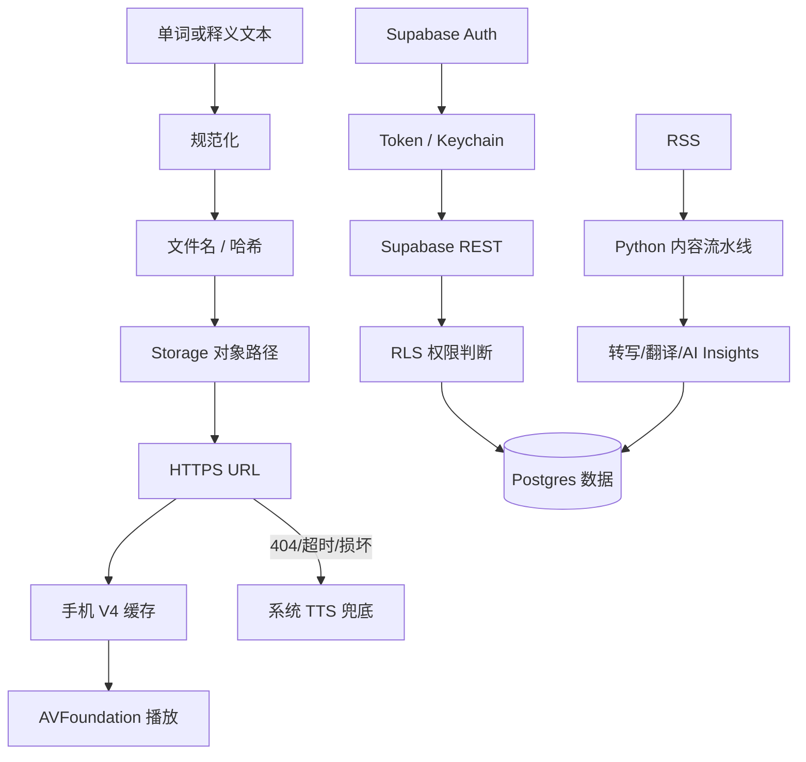

# 听会儿 App 技术名词解释

> 适用对象：产品、运营、测试、开发，以及希望整体理解项目但不熟悉技术术语的人员。  
> 更新时间：2026-10-21  
> 配套文档：[听会儿 App 架构总览](./app-architecture-overview.md)

## 1. 阅读方法

本文中的每个重点名词尽量回答四个问题：

1. **是什么**：用通俗语言解释概念；
2. **常规怎么做**：一般软件项目如何处理；
3. **听会儿怎么做**：当前 App 的实际实现；
4. **排查重点**：出现问题时先检查什么。

本文描述的是当前项目实现。技术方案调整后，应同步更新本文。

## 2. 快速认识整个系统

听会儿可以先理解成三部分：

```text
iPhone 上的 App
    ↓ 读取和提交数据
Supabase 云端
    ↑ 接收加工完成的内容
Python 后端脚本
```

- **iOS App**：用户真正使用的客户端；
- **Supabase**：保存账户、学习进度、播客内容和音频文件；
- **Python 脚本**：批量生成自然语音、处理播客、转写、翻译、检查和发布。

## 3. 客户端与界面相关名词

### 3.1 客户端（Client）

**是什么**

客户端是安装在用户设备上的软件。听会儿的客户端就是用户从 App Store 或测试渠道安装到 iPhone 上的 App。

**常规怎么做**

客户端负责显示页面、响应操作、播放媒体，并通过网络访问云端服务。敏感密钥和耗时批处理通常不放在客户端。

**听会儿怎么做**

听会儿客户端使用 Swift 和 SwiftUI 开发，负责词书学习、播客精听、音频播放、本地缓存、登录和学习进度同步。

**排查重点**

先确认测试手机安装的是不是最新构建，再确认客户端配置、网络和云端内容是否正确。

### 3.2 原生 App（Native App）

**是什么**

原生 App 是使用目标操作系统官方技术开发的应用，而不是在 App 内套一个网页。

**常规怎么做**

iOS 原生应用通常使用 Swift/Objective-C 和 Apple 提供的系统框架。

**听会儿怎么做**

听会儿是原生 iOS App，使用 SwiftUI 构建界面，使用 AVFoundation 播放音频，使用 Keychain 保存登录凭证。

### 3.3 Swift

**是什么**

Swift 是 Apple 推出的编程语言，主要用于开发 iPhone、iPad 和 Mac 应用。

**听会儿怎么做**

听会儿客户端主要使用 Swift 5。代码位于 `听会儿/` 目录。

### 3.4 SwiftUI

**是什么**

SwiftUI 是 Apple 的界面开发框架。开发者描述“页面在某种状态下应该长什么样”，状态变化后页面自动刷新。

**常规怎么做**

页面通常拆成小组件，数据放在 State 或 Store 中，避免所有逻辑集中在一个页面文件。

**听会儿怎么做**

App 入口是 `___App.swift`，根页面是 `ContentView.swift`。词书和播客页面都使用 SwiftUI。

**排查重点**

页面没有更新时，需要判断是数据没有变化，还是数据变化后没有正确通知 SwiftUI。

### 3.5 状态（State）

**是什么**

状态是 App 在某一时刻需要记住的信息，例如当前单词、播放进度、登录用户、播放速度和弹窗是否显示。

**常规怎么做**

短期页面状态留在页面内；多个页面共享的状态放入 Store；需要长期保存的状态写入本地或云端。

**听会儿怎么做**

- 页面临时状态：SwiftUI `@State`；
- 跨页面状态：`ObservableObject` Store；
- 普通本地状态：UserDefaults；
- 登录 Token：Keychain；
- 跨设备数据：Supabase。

### 3.6 Store

**是什么**

Store 是集中管理某一类状态和业务操作的对象。它不是应用商店，而是代码中的“状态仓库”。

**常规怎么做**

一个 Store 通常管理一个清晰领域，例如账户、播放器、学习进度或播客目录。

**听会儿怎么做**

项目中有 `AuthStore`、`LearningProgressStore`、`PodcastPlayerStore`、`PodcastCatalogStore` 等。

**排查重点**

如果多个页面显示不一致，应检查它们是否使用同一个 Store，以及 Store 是否正确发布了状态变化。

### 3.7 数据模型（Model）

**是什么**

模型是代码对现实数据的结构化描述。例如一个单词可能包含拼写、音标、释义和词书位置。

**听会儿怎么做**

词书相关模型主要在 `Models.swift`；播客、单集、逐句文本、AI 摘要等模型主要在 `PodcastFeature.swift`。

### 3.8 Bundle（应用包）

**是什么**

Bundle 是随 App 一起安装到手机上的资源集合，包括程序、图片、配置和内置 JSON 文件。

**常规怎么做**

适合保存不会频繁变化、需要离线可用的内容。Bundle 内资源在 App 安装后通常只读，更新需要发布新版。

**听会儿怎么做**

德语 A1/A2/B1、雅思和考研词书 JSON 位于 `听会儿/data/`，随 App 一起打包。

**排查重点**

如果只修改了本地词书源文件但手机内容没变，需要重新构建并安装 App；修改 Supabase 音频不能改变 Bundle 中的词条文字。

## 4. 网络与云服务相关名词

### 4.1 后端（Backend）

**是什么**

后端是用户看不到、但为 App 提供数据和内容加工能力的部分。

**常规怎么做**

后端会处理数据库、身份验证、文件存储、定时任务、第三方服务密钥和复杂计算。

**听会儿怎么做**

听会儿的后端由 Supabase 云服务和 `backend/scripts/` 中的 Python 批处理脚本共同组成。目前不是一个长期运行的传统 Web 服务。

### 4.2 Supabase

**是什么**

Supabase 是一套云端后端服务，提供数据库、用户认证、文件存储、自动 REST 接口和云函数。

**听会儿怎么做**

Supabase 保存用户、学习进度、播客内容和自然音频。客户端通过 `SupabaseClient.swift` 和 `SupabaseConfig.swift` 接入。

**排查重点**

需要区分四类问题：登录问题、数据库数据问题、Storage 文件问题、RLS 权限问题。

### 4.3 API

**是什么**

API 是两个软件之间约定好的沟通方式。可以把它理解为“窗口和办事规则”。

**常规怎么做**

客户端按规定的网址、方法和参数发送请求，服务端返回状态码和 JSON 等结果。

**听会儿怎么做**

客户端使用 `URLSession` 直接调用 Supabase Auth、REST 和 Storage API。Python 脚本也会通过 API 上传和验证内容。

### 4.4 REST

**是什么**

REST 是常见的网络 API 风格，一般通过 URL 和 HTTP 方法读取、新增、修改或删除数据。

**听会儿怎么做**

`SupabaseClient.swift` 直接访问 Supabase 自动生成的 REST 接口，没有引入 Supabase Swift SDK。

### 4.5 HTTP 与 HTTPS

**是什么**

HTTP 是网络传输协议；HTTPS 是加密版本，可以降低请求内容在传输过程中被窃听或修改的风险。

**听会儿怎么做**

客户端通过 HTTPS 访问 Supabase 和远端音频。网络请求失败时，短音频链路可以退回缓存或系统 TTS。

### 4.6 URL

**是什么**

URL 是网络资源地址。例如一个 MP3 在 Supabase Storage 中有唯一的公开 URL。

**听会儿怎么做**

学习音频 URL 由 Supabase 项目地址、Storage API、bucket 和对象路径共同组成。

```text
https://{project}.supabase.co/storage/v1/object/public/
learning-audio/v2/words/en-US/{book}/{file}.mp3
```

URL 中 `/storage/v1/` 是 Supabase 接口版本，不是听会儿音频内容版本。

### 4.7 JSON 与 JSONL

**是什么**

JSON 是一种结构化文本格式；JSONL 是一行一个 JSON 对象，适合流式处理和大型数据集。

**常规怎么做**

JSON 常用于配置、API 返回值和小型数据文件。JSONL 常用于批处理、日志或逐条记录。

**听会儿怎么做**

内置词书主要使用 JSON；后端加工过程也可能使用 JSON/JSONL 作为清单和中间结果。

### 4.8 状态码（Status Code）

**是什么**

状态码是服务器对请求结果的简短说明。

常见状态码：

| 状态码 | 一般含义 |
|---|---|
| `200` | 请求成功 |
| `201` | 创建成功 |
| `400` | 请求内容不正确 |
| `401` | 未登录或 Token 无效 |
| `403` | 已识别用户，但没有权限 |
| `404` | 对象或数据不存在 |
| `409` | 数据冲突，例如重复对象 |
| `500` | 服务端内部错误 |

**听会儿怎么做**

音频遇到 404 通常表示计算出的对象路径不存在；这时播放器应继续走旧缓存或系统发音兜底。

### 4.9 超时（Timeout）

**是什么**

客户端不能无限等待网络结果。超过设定时间仍没有完成，就将请求判定为超时。

**常规怎么做**

根据请求类型设置合理时限，必要时有限重试，并准备降级方案。

**听会儿怎么做**

短音频下载失败不应卡住学习流程，而应尝试可用缓存，最终使用系统 TTS。

### 4.10 重试（Retry）

**是什么**

网络临时失败后再次尝试请求称为重试。

**常规怎么做**

只对可能恢复的错误重试，通常增加间隔和次数上限，避免无限请求。

**听会儿怎么做**

重试必须与缓存和 TTS 兜底配合；如果对象本身不存在，反复请求不会解决问题，需要检查生成和上传路径。

## 5. 缓存与本地存储相关名词

### 5.1 缓存（Cache）

**是什么**

缓存是为了下次更快使用而暂时保留的数据副本。例如第一次从云端下载发音，之后直接播放手机里的副本。

**常规怎么做**

缓存通常包含：

- 缓存键：如何确定两次请求是不是同一个资源；
- 缓存目录：副本保存在什么位置；
- 有效期：多久重新检查一次；
- 淘汰规则：何时删除旧文件；
- 失败策略：网络失败时能否继续用旧缓存。

缓存提升速度、减少流量，也会带来“云端已更新但用户仍听到旧内容”的风险。

**听会儿怎么做**

学习音频缓存在：

```text
Library/Caches/TingHuiErAudioV4/...
```

它位于每台用户 iPhone 上该 App 的沙盒中，不是项目源码路径，也不是 Supabase 路径。当前方案保留缓存以提升播放体验，同时按刷新策略重新请求远端文件。

**排查重点**

当 Supabase 文件已经更新但真机仍播放旧音频时，依次检查：

1. 实际请求路径是否正确；
2. 是否仍在使用旧缓存目录；
3. 缓存是否达到刷新时间；
4. 新下载是否成功写入；
5. 当前听到的是否是系统 TTS，而不是缓存。

### 5.2 缓存版本（Cache Namespace Version）

**是什么**

缓存版本是缓存目录或缓存键的一部分。改变版本相当于让新代码使用一套新的抽屉，从而不再误读旧抽屉里的文件。

**常规怎么做**

当缓存格式、文件内容标准或路径算法发生不兼容变化时提升缓存版本。不能每次内容更新都无限提升版本，否则会留下大量无用文件。

**听会儿怎么做**

`TingHuiErAudioV4` 中的 `V4` 是本地缓存命名空间版本。它不是 Supabase API 版本，也不是自然语音模型版本。

### 5.3 缓存键（Cache Key）

**是什么**

缓存键是本地识别资源的唯一标识。它决定某次播放会复用哪个文件。

**常规怎么做**

缓存键通常根据 URL、语言、资源类型、内容版本或稳定哈希生成。

**听会儿怎么做**

听会儿需要把语言、词书、单词/释义类型和规范化内容正确纳入路径或文件名，避免不同资源错误共用同一个缓存。

### 5.4 缓存失效（Invalidation）

**是什么**

缓存失效是让旧副本不再被无期限使用，并重新获取源数据的过程。

**常规怎么做**

常用方法包括有效期、版本号、内容哈希、服务端 ETag、手动清除和 URL 查询参数。

**听会儿怎么做**

当前学习音频使用缓存目录版本和周期性 cache-buster，允许客户端在保留缓存模式的同时重新检查云端内容。

### 5.5 Cache-buster

**是什么**

Cache-buster 是添加到 URL 上、用于绕开中间缓存的变化参数，例如：

```text
audio.mp3?refresh=2026102114
```

服务器对象没有换路径，但代理或系统会把变化后的 URL 视为一次新请求。

**常规怎么做**

参数不能每次播放都随机变化，否则完全失去缓存意义；通常按版本、小时或发布日期变化。

**听会儿怎么做**

学习音频采用按时间窗口轮换的参数，目的是避免 Supabase 文件覆盖后仍长期读到旧网络缓存。

### 5.6 App 沙盒（Sandbox）

**是什么**

iOS 为每个 App 分配独立文件空间，普通情况下一个 App 不能随意读取另一个 App 的文件。

**听会儿怎么做**

`Library/Caches/TingHuiErAudioV4` 是听会儿沙盒中的相对路径。每台设备、每次安装所对应的完整绝对路径都可能不同。

### 5.7 UserDefaults

**是什么**

UserDefaults 是 iOS 保存少量普通配置的机制。

**常规怎么做**

适合保存播放速度、开关、最后选择等小数据，不适合大文件、复杂数据库和敏感 Token。

**听会儿怎么做**

用于保存偏好、本地进度副本和部分状态。登录凭证不应只保存在 UserDefaults。

### 5.8 Keychain

**是什么**

Keychain 是 Apple 提供的安全凭证存储，用于密码、Token 等敏感小数据。

**听会儿怎么做**

`KeychainStore.swift` 保存 Supabase 会话相关 Token；`AuthStore.swift` 管理登录状态和 Token 刷新。

### 5.9 持久化（Persistence）

**是什么**

持久化是指 App 退出或手机重启后数据仍然存在。

**听会儿怎么做**

- 页面状态通常不持久化；
- 用户偏好和部分进度写入 UserDefaults；
- Token 写入 Keychain；
- 跨设备数据写入 Supabase；
- 音频副本写入 Caches，但系统有权清理缓存。

## 6. 音频相关名词

### 6.1 TTS（Text to Speech）

**是什么**

TTS 是“文字转语音”。输入一段文字，由语音引擎合成为音频。

**常规怎么做**

可以实时调用系统 TTS，也可以提前批量生成 MP3。实时 TTS 灵活但声音受设备和系统影响；预生成音频效果稳定，但需要生成、存储和分发。

**听会儿怎么做**

正常情况播放 Supabase 中提前生成的自然音频；远端和缓存都不可用时，才使用 iOS 系统 TTS 兜底。

### 6.2 自然音频 / 预生成音频

**是什么**

自然音频在本项目中特指后端提前用统一神经网络音色生成并上传的 MP3，而不是播放时由手机临时朗读。

**听会儿怎么做**

英语、德语单词及中文释义按稳定对象路径放在 Supabase `learning-audio` bucket 中。客户端优先下载和缓存这些文件。

### 6.3 系统发音 / 系统 TTS

**是什么**

系统发音由 iPhone 自带语音引擎实时生成。不同系统版本、已下载语音和设备设置可能造成听感差异。

**听会儿怎么做**

系统音是异常兜底，不是期望的正常播放来源。如果某个单词一直是系统音，通常说明远端对象不存在、路径不匹配、下载失败或音频无法播放。

### 6.4 降级与兜底（Fallback）

**是什么**

主方案失败后切换到次优但可用的方案，称为降级或兜底。

**常规怎么做**

兜底的目标是保障核心功能不中断，同时应留下足够日志，避免错误长期被兜底掩盖。

**听会儿怎么做**

学习发音的优先顺序可以概括为：

```text
远端最新自然音频 → 可用本地缓存 → 系统 TTS
```

具体播放时是否先用缓存取决于缓存有效期；刷新失败时可保留旧缓存保证可用性。

### 6.5 播放队列（Queue）

**是什么**

播放队列是等待依次播放的一组音频任务。

**听会儿怎么做**

单词学习需要协调单词音频、停顿和释义音频。`AudioPlayerManager.swift` 负责短音频播放及其状态。

### 6.6 播放速度（Rate）

**是什么**

播放速度是音频相对于原始速度的倍率，例如 `1.0` 是原速，`1.5` 是更快播放。

**听会儿怎么做**

用户速度由统一设置控制，产品规则限定在 `0.5...2.0`。中文释义目前按用户设置速度乘以 `1.5` 进行补偿，以改善中文释义相对英语/德语显得过慢的问题，最终仍需遵守播放器允许范围。

### 6.7 音频间隔

**是什么**

音频间隔是单词读完后到释义开始前的等待时间。它与播放速度是两个不同参数。

**常规怎么做**

播放速度控制音频内部快慢，间隔控制两个片段之间的停顿。感觉“等很久”时，不一定是语速慢，也可能是固定延时、音频尾部静音或状态回调较晚。

**听会儿怎么做**

排查单词和翻译间隔时，需要同时检查队列延时、MP3 尾部静音、播放器完成回调和下一段下载耗时。

### 6.8 AVFoundation

**是什么**

AVFoundation 是 Apple 的音视频框架，可用于播放、录制、处理音频和管理音频会话。

**听会儿怎么做**

词汇短音频和播客播放均使用 Apple 音频能力，具体封装分别位于学习音频管理器和播客播放器 Store。

### 6.9 MP3

**是什么**

MP3 是常见压缩音频格式，文件较小，兼容性高。

**听会儿怎么做**

预生成学习音频以 MP3 形式上传。仅确认 URL 返回 200 不足以证明音频正确，还需要检查文件大小、时长和实际声音。

### 6.10 音色（Voice）

**是什么**

音色表示使用哪一个合成说话人。语言相同但 Voice 不同，听感、情绪和节奏会明显不同。

**听会儿怎么做**

同一类内容应尽量固定 Voice 和生成参数。例如雅思和考研的中文释义需要统一音色；相同释义优先复用同一个音频对象。

### 6.11 语言代码与区域代码

**是什么**

`en-US`、`de-DE`、`zh-CN` 等代码同时描述语言和地区。同一种语言在不同地区可能有口音、拼写和声音差异。

**听会儿怎么做**

英语单词目录使用 `en-US`，德语使用 `de-DE`，中文释义放在 `meanings/zh`。代码大小写和路径必须与实际对象保持一致。

## 7. 音频文件定位相关名词

### 7.1 Storage（对象存储）

**是什么**

对象存储是专门保存图片、音频、视频等文件的云服务。每个文件称为一个对象。

**常规怎么做**

文件放在 bucket 中，通过对象路径定位。数据库通常只保存路径或元数据，不直接保存大量 MP3 二进制内容。

**听会儿怎么做**

自然音频位于 Supabase Storage 的 `learning-audio` bucket。

### 7.2 Bucket（存储桶）

**是什么**

Bucket 是对象存储中的顶层容器，可以理解为一个有独立权限规则的大文件柜。

**听会儿怎么做**

`learning-audio` 用于学习音频，并允许客户端公开读取。隐私文件不应混放在这个公开 bucket。

### 7.3 对象路径（Object Path）

**是什么**

对象路径是 bucket 内文件的位置。对象存储看起来像文件夹，实际核心是完整路径字符串。

**听会儿怎么做**

典型路径：

```text
v2/words/en-US/IELTS_9400/example_1234.mp3
meanings/zh/规范化释义_abcdef12.mp3
```

路径中任何字符、大小写、语言、词书或哈希不同，都可能变成另一个对象并导致 404。

### 7.4 内容版本（例如 `v2`）

**是什么**

内容版本是项目自己定义的目录规则，用于让一套新资源与旧资源并存或切换。

**听会儿怎么做**

英语和德语单词自然音频目前配置为 `v2`。这个值位于 `SupabaseConfig.swift`，只影响项目定义的远端对象路径。

### 7.5 哈希（Hash）

**是什么**

哈希是把一段内容计算成相对短且稳定的标识。同样输入通常得到同样结果，输入稍有不同结果就会变化。

**常规怎么做**

常用于文件名、防重复、完整性比较和缓存键。哈希不是加密，也不能直接还原原文。

**听会儿怎么做**

释义音频文件名会组合规范化文本和短哈希，既方便识别，又降低同名冲突。客户端和生成脚本必须使用完全相同的算法。

### 7.6 规范化（Normalization）

**是什么**

规范化是把同一内容的不同书写形式转成统一形式，例如处理空格、大小写、标点和特殊字符。

**常规怎么做**

规范化规则必须稳定，并在生产端和消费端保持一致，否则同一内容会生成不同路径。

**听会儿怎么做**

单词和释义在生成文件名之前会进行清理。`Café`、弯引号、斜杠、括号、重音符号等特殊字符是重点测试对象。

### 7.7 Manifest（清单）

**是什么**

Manifest 是一次批处理需要操作哪些资源的明确清单，通常包含源文本、本地文件、目标路径和状态。

**常规怎么做**

先生成清单，再执行生成、上传和验证，可以避免“脚本扫到什么就处理什么”带来的不可控变化。

**听会儿怎么做**

大批量学习音频更新通过 manifest 确定需要生成和覆盖的对象；上传和验证脚本可以读取同一清单。

### 7.8 覆盖上传（Upsert / Overwrite）

**是什么**

当目标路径已经存在时，用新文件替换旧文件称为覆盖上传。Upsert 通常表示存在就更新，不存在就创建。

**常规怎么做**

覆盖前应核对目标清单，覆盖后应重新下载比对，并准备可恢复的备份或生成源。

**听会儿怎么做**

自然音色升级可以保持对象路径不变，覆盖相同路径的 MP3。这样客户端无需发版修改路径，但必须处理网络缓存和本地缓存刷新。

### 7.9 去重与复用

**是什么**

相同内容只保存一份，多个业务记录共同引用它，称为去重和复用。

**听会儿怎么做**

雅思与考研词书中完全相同的中文释义可复用同一个 `meanings/zh` 音频，降低生成量和 Storage 占用。只有考研新增或不同的释义才单独生成。

## 8. 用户与权限相关名词

### 8.1 Authentication（认证 / Auth）

**是什么**

认证解决“你是谁”的问题，例如邮箱和密码登录。

**听会儿怎么做**

使用 Supabase Auth。`AuthStore.swift` 负责登录状态、会话恢复和 Token 刷新。

### 8.2 Authorization（授权）

**是什么**

授权解决“你能做什么”的问题。已经登录不代表可以读取或修改所有数据。

**听会儿怎么做**

数据库授权主要由 Supabase RLS 控制，例如用户只能修改自己的学习进度。

### 8.3 Token

**是什么**

Token 是登录成功后服务端签发的临时身份凭证。客户端后续请求携带 Token，服务端据此识别用户。

**常规怎么做**

访问 Token 有有效期；刷新 Token 用于换取新的访问 Token。凭证应安全保存，日志中不应完整输出。

**听会儿怎么做**

Token 保存于 Keychain，由 `AuthStore` 管理刷新，网络层在需要身份的请求中携带它。

### 8.4 anon key / publishable key

**是什么**

这是允许公开放进客户端的 Supabase 项目标识凭证。它本身不能代替数据库权限设计。

**听会儿怎么做**

publishable key 位于 `SupabaseConfig.swift`。即使别人看到它，也应因为 RLS 而无法访问不属于自己的私有数据。

### 8.5 service_role key

**是什么**

这是 Supabase 的高权限服务端密钥，通常能绕过 RLS，泄露后风险很高。

**听会儿怎么做**

只能用于可信后端脚本或安全运行环境，并放入不提交 Git 的环境配置。绝不能写进 iOS App。

### 8.6 RLS（Row Level Security）

**是什么**

RLS 是数据库的行级安全规则。它可以规定某个用户只能看到或修改符合条件的记录。

**常规怎么做**

私有表默认拒绝访问，再添加明确策略；不能只依靠客户端隐藏按钮来保护数据。

**听会儿怎么做**

用户进度、收藏和用户状态按当前用户隔离；已发布播客内容按公开读取策略提供给客户端。

### 8.7 Edge Function

**是什么**

Edge Function 是部署在云端的小型服务端函数，适合处理客户端不能安全执行的高权限操作。

**听会儿怎么做**

`supabase/functions/delete-account/` 用于注销账户。删除 Auth 用户需要服务端权限，因此不能只靠客户端直连完成。

## 9. 数据库相关名词

### 9.1 数据库（Database）

**是什么**

数据库用于结构化保存和查询数据，例如用户、节目、单集和学习进度。

**听会儿怎么做**

使用 Supabase 提供的 PostgreSQL。表结构和安全策略主要位于 `supabase/sql/`。

### 9.2 表、行、列

**是什么**

- 表：同类数据的集合，例如 `episodes`；
- 行：一条具体记录，例如某一期节目；
- 列：记录中的一个字段，例如标题或发布日期。

### 9.3 Schema / 数据结构

**是什么**

Schema 描述数据库有哪些表、字段、类型、关系和约束。广义上也常指一类数据的结构定义。

**听会儿怎么做**

数据库结构通过 SQL 文件维护；客户端 Swift 模型需要与 API 返回结构匹配。

### 9.4 SQL

**是什么**

SQL 是创建、查询和修改关系型数据库的语言。

**听会儿怎么做**

`supabase/sql/` 中的 SQL 用于创建用户、进度、播客、逐句内容、AI 洞察以及对应 RLS 策略。

### 9.5 Migration（数据库迁移）

**是什么**

迁移是按顺序记录数据库结构如何从旧版本演进到新版本的脚本。

**常规怎么做**

每次结构变更都生成不可随意修改的迁移，记录执行顺序，并准备兼容与回滚方案。

**听会儿怎么做**

目前 SQL 文件承担了较多建表和升级职责。后续应进一步固定执行顺序和已执行版本，减少不同环境结构不一致。

### 9.6 同步（Sync）

**是什么**

同步是让本地状态和云端状态保持一致。

**常规怎么做**

需要确定谁是权威来源、离线改动如何处理，以及两端同时变化时如何解决冲突。

**听会儿怎么做**

学习进度保留本地副本，登录后同步 Supabase。排查时应区分“本地显示已变化”和“云端确实写入成功”。

## 10. 播客处理相关名词

### 10.1 RSS

**是什么**

RSS 是网站或播客用于发布更新列表的标准格式，通常包含节目标题、发布日期、说明和音频地址。

**听会儿怎么做**

播客来源配置在 `backend/config/rss_sources.json`，Python 流水线从 RSS 获取节目和单集。

### 10.2 Episode（单集）

**是什么**

Episode 是一期具体播客节目。

**听会儿怎么做**

单集包含标题、日期、音频、处理状态、发布状态等，并关联逐句文本和 AI 学习内容。

### 10.3 Transcript（转写文本）

**是什么**

Transcript 是把音频中的讲话转换成文字后的结果。

**常规怎么做**

优先使用内容方提供的字幕；没有字幕时再用语音识别模型生成，并做时间轴和质量检查。

**听会儿怎么做**

流水线先探测 VTT/SRT 等字幕能力，没有可用字幕时可使用 Whisper 转写。

### 10.4 VTT / SRT

**是什么**

VTT 和 SRT 是常见字幕文件格式，包含文字以及每句话对应的开始和结束时间。

**听会儿怎么做**

如果播客源提供字幕，后端可以直接解析，通常比重新进行语音识别更快、成本更低。

### 10.5 Whisper

**是什么**

Whisper 是语音识别模型系列，用于将音频转成文本。

**听会儿怎么做**

后端可使用 faster-whisper 或 openai-whisper 作为没有现成字幕时的转写方案，不在 iPhone 上运行全量转写。

### 10.6 时间轴 / 时间戳

**是什么**

时间戳记录一句话在音频中的起止位置，用于播放时同步高亮字幕或跳转。

**排查重点**

字幕内容正确但高亮错位时，应检查转写时间戳、分句合并规则和播放器当前时间，而不是只检查翻译文本。

### 10.7 内容流水线（Pipeline）

**是什么**

流水线是把一个复杂任务拆成多个按顺序执行的阶段，每个阶段接受上一步结果并产生下一步输入。

**听会儿怎么做**

播客大致经过：RSS 导入、能力探测、字幕解析/转写、翻译、AI 内容生成、质量校验、发布。

### 10.8 AI Insights

**是什么**

AI Insights 是根据播客内容提前生成的摘要、重点、难词等辅助学习信息。

**听会儿怎么做**

内容由后端预生成并写入 Supabase。客户端只负责读取展示，避免暴露 AI 密钥和让用户等待实时生成。

### 10.9 内容状态

**是什么**

内容从抓取到上线会经过多个状态，例如待转写、已转写、验证失败、可发布、已发布。

**常规怎么做**

状态应明确区分“处理完成”和“允许用户看到”，避免半成品意外上线。

**听会儿怎么做**

播客表中有音频、转写、验证和编辑发布等状态。客户端查询条件通常只取满足上线要求的单集。

## 11. 后端脚本与发布相关名词

### 11.1 Python 脚本

**是什么**

Python 脚本是用于自动执行批量任务的程序。

**听会儿怎么做**

`backend/scripts/` 包含播客处理、自然音频生成、上传、远端校验和发布等脚本。

### 11.2 环境变量（Environment Variable）

**是什么**

环境变量是在程序外部提供的运行配置，常用于服务地址、密钥和开关。

**常规怎么做**

敏感值不写死在源码中，不提交 Git；不同环境使用不同配置。

**听会儿怎么做**

Supabase `service_role`、AI Key 等后端凭证应由 `backend/.env` 或安全运行环境提供。

### 11.3 依赖（Dependency）

**是什么**

依赖是项目使用的第三方代码库，例如用于网络请求、RSS 解析或语音生成的库。

**听会儿怎么做**

Python 依赖记录在 `requirements.txt` 和 `requirements-transcription.txt`。iOS 端目前主要使用 Apple 系统框架。

### 11.4 生成（Generate）

**是什么**

根据源文本或配置批量产生新文件，例如把中文释义生成 MP3。

**听会儿怎么做**

生成文件先保存在 `backend/generated/`，经过检查后再上传 Supabase。生成完成不等于已经上线。

### 11.5 上传（Upload）

**是什么**

把本地文件传输到云端存储。

**听会儿怎么做**

学习音频上传到 `learning-audio` bucket。必须确认目标对象路径、是否覆盖、上传数量和失败列表。

### 11.6 校验（Validation / Verification）

**是什么**

校验是判断结果是否满足预期。它可能检查格式、数量、内容、状态或业务规则。

**听会儿怎么做**

音频校验至少包括：

- 应生成文件是否全部存在；
- MP3 是否非空且能读取；
- 远端对象是否返回成功；
- 远端内容是否与本地待发布文件一致；
- 抽样听感、语言和音色是否正确。

### 11.7 审计（Audit）

**是什么**

审计是系统性检查已有数据，找出缺失、重复、异常或不符合规则的部分。

**听会儿怎么做**

音频审计用于发现缺失文件、异常短文件、特殊字符路径和仍会触发系统 TTS 的词条。

### 11.8 发布（Publish）

**是什么**

发布是让经过检查的内容真正对用户可用。文件生成、上传和发布不是同一件事。

**听会儿怎么做**

- App 发布：构建并通过分发渠道让用户安装；
- 音频发布：将文件上传到客户端会读取的正式对象路径；
- 播客发布：内容加工和验证完成后，修改为客户端查询得到的发布状态。

### 11.9 部署（Deploy）

**是什么**

部署是把代码或服务安装到目标运行环境。发布更强调“用户可见”，部署更强调“技术上已经放到环境中”。

### 11.10 构建（Build）

**是什么**

构建是把源代码和资源编译、打包成可以运行或安装的 App。

**听会儿怎么做**

修改 Swift、内置 JSON 或 App 配置后，需要重新构建并安装。只替换既定 Supabase 路径下的音频通常不需要重新构建。

### 11.11 Debug 与 Release

**是什么**

- Debug：供开发调试，日志和检查能力较多；
- Release：供正式发布，通常经过优化并减少调试信息。

**排查重点**

调试机正常不代表 App Store 版本一定相同。需要核对构建配置、版本号、环境地址和安装来源。

### 11.12 版本号

**是什么**

项目中可能同时存在多种版本号，它们属于不同层级。

| 类型 | 例子 | 含义 |
|---|---|---|
| App 版本 | `1.x` | 用户安装的应用版本 |
| 构建号 | Build number | 同一个 App 版本下的构建批次 |
| Storage API 版本 | `/storage/v1/` | Supabase 接口版本 |
| 音频内容版本 | `v2/words/...` | 听会儿定义的远端资源版本 |
| 缓存版本 | `TingHuiErAudioV4` | 手机上的缓存命名空间 |
| 数据库迁移版本 | SQL 执行顺序 | 云端表结构演进版本 |

排查问题时不能只说“是不是最新版”，而应明确问的是哪一种版本。

## 12. 稳定性与排障相关名词

### 12.1 日志（Log）

**是什么**

日志是程序运行时记录的事件，例如请求路径、状态码、播放来源和错误原因。

**常规怎么做**

日志应足够定位问题，但不能泄露 Token、密码和用户隐私。正式版通常控制日志级别。

**听会儿怎么做**

音频排查最有价值的日志包括：词条、资源类型、远端对象路径、缓存命中状态、HTTP 状态码和最终播放来源。

### 12.2 可观测性（Observability）

**是什么**

可观测性是通过日志、指标和追踪了解系统内部实际发生了什么。

**听会儿怎么做**

后续建议统计自然音频命中率、404 数量、下载失败率、系统 TTS 兜底率和播客流水线失败阶段。

### 12.3 异常（Error / Exception）

**是什么**

异常是程序未按预期完成某个操作。网络不可用、JSON 解码失败、音频损坏都属于异常。

**常规怎么做**

异常需要被捕获、记录并转成用户可理解的状态；不可恢复时才终止当前流程。

### 12.4 崩溃（Crash）

**是什么**

崩溃是 App 进程意外终止。一次请求失败或回退到系统发音不等于崩溃。

### 12.5 降级可用

**是什么**

系统部分能力异常时，核心流程仍能继续，只是体验略有降低。

**听会儿怎么做**

远端自然语音不可用时仍能通过旧缓存或系统 TTS 学习，就是降级可用。

### 12.6 单元测试（Unit Test）

**是什么**

单元测试是自动检查一小段逻辑是否符合预期的代码。

**听会儿怎么做**

当前测试量较少。最应补充的是音频路径、特殊字符规范化、缓存失效、速度计算、进度合并和网络模型解码测试。

### 12.7 回归测试（Regression Test）

**是什么**

修改功能后重新检查原本正常的能力有没有被破坏。

**听会儿怎么做**

音频逻辑更新后至少应回归：德语、雅思、考研、中文释义、特殊字符、首次下载、旧缓存、断网和系统 TTS 兜底。

### 12.8 灰度 / 小批量验证

**是什么**

先让少量数据或少量用户使用新方案，确认稳定后再全量发布。

**听会儿怎么做**

批量替换音频前先生成和上传小批样本，在真机确认路径、音色、速度、缓存刷新和回退，再执行全量任务。

### 12.9 幂等（Idempotent）

**是什么**

同一个任务重复执行多次，最终结果与执行一次相同，称为幂等。

**常规怎么做**

批处理和发布脚本应尽量支持安全重跑，避免重复记录、错误累计或路径漂移。

**听会儿怎么做**

使用稳定文件名、manifest 和覆盖上传，有助于让音频生成与发布任务可恢复、可重复执行。

## 13. 常见说法的准确含义

### “现在还是系统声音”

准确含义应是：最终播放来源落到了 iOS 系统 TTS。可能原因包括：

- Supabase 中没有该对象；
- 客户端和生成脚本计算的路径不一致；
- 特殊字符规范化不一致；
- 网络请求失败或超时；
- 下载文件损坏或播放器无法解码；
- 设备仍运行旧版代码；
- 误把另一种自然音色当成系统音。

### “Supabase 中还是 v1”

如果看到的是：

```text
/storage/v1/object/public/
```

它只是 Supabase Storage API 版本。真正的听会儿音频版本要看后面的对象路径是否为：

```text
learning-audio/v2/words/...
```

### “清除 V4 缓存”

表示删除手机 App 沙盒中 `TingHuiErAudioV4` 的临时音频副本，不会删除 Supabase 文件，也不会修改项目源代码。

### “音频已经生成”

只表示本地有文件，不代表：

- 已完成校验；
- 已上传 Supabase；
- 上传到了正确路径；
- 客户端已经刷新缓存；
- 用户当前实际听到该文件。

### “音频已经上传”

还需要继续确认：

- 上传对象数量是否正确；
- 是否覆盖了旧对象；
- 远端内容是否与本地一致；
- 客户端路径是否指向这些对象；
- 真机最终播放来源是否为自然音频。

### “可以先发布 App，后面再补音频”

在以下条件满足时可以：

1. 客户端已经使用稳定的远端路径算法；
2. 客户端会定期刷新缓存；
3. 新安装和覆盖更新都不会永久命中旧缓存；
4. 缺失音频有系统 TTS 兜底；
5. 后续上传仍保持客户端预期的对象路径。

### “中文释义比外语慢”

需要区分三个问题：

- 中文音频本身说得慢：调整中文播放倍率或重新生成音频；
- 单词与释义之间等得久：调整片段间隔或减少下一段下载等待；
- 中文 MP3 尾部静音长：需要处理生成文件本身。

## 14. 常用问题定位表

| 现象 | 优先检查 | 主要代码/位置 |
|---|---|---|
| 某个词是系统音 | 远端路径、404、特殊字符、最终播放来源 | `AudioPlayerManager.swift` |
| 云端换音频后仍是旧声音 | 网络缓存、本地 V4 缓存、刷新窗口 | `AudioPlayerManager.swift` |
| 新用户也听到旧音频 | Supabase 正式路径对象是否真的被覆盖 | Storage、上传/验证脚本 |
| 中文释义声音不一致 | 是否同路径复用、Voice 和生成批次 | `meanings/zh`、manifest |
| 单词和释义间隔太长 | 固定停顿、下载等待、尾部静音 | 播放队列与 MP3 文件 |
| 学习进度不同步 | 登录态、本地写入、云端写入和冲突规则 | `LearningProgressStore.swift` |
| 登录后很快失效 | Token 保存和刷新 | `AuthStore.swift`、`KeychainStore.swift` |
| 播客列表没有新内容 | 发布状态、查询条件、RLS | `episodes`、`SupabaseClient.swift` |
| 播客有音频无字幕 | transcript 状态、字幕解析/Whisper 任务 | 后端流水线 |
| App 修改后真机没变化 | 安装的构建和 Bundle 资源 | Xcode 构建/安装 |

## 15. 术语之间的关系



## 16. 相关文档

- [听会儿 App 架构总览](./app-architecture-overview.md)
- [学习音频路径说明](./learning-audio-paths.md)
- [自然音频上线计划](./natural-audio-rollout-plan.md)
- [播客多源架构](./podcast_multi_source_architecture.md)
- [播客技术架构 MVP](./podcast_technical_architecture_mvp.md)

---

维护建议：出现一个需要反复解释的新术语时，就在本文增加“是什么、常规怎么做、听会儿怎么做、排查重点”，不要只记录一个孤立定义。
